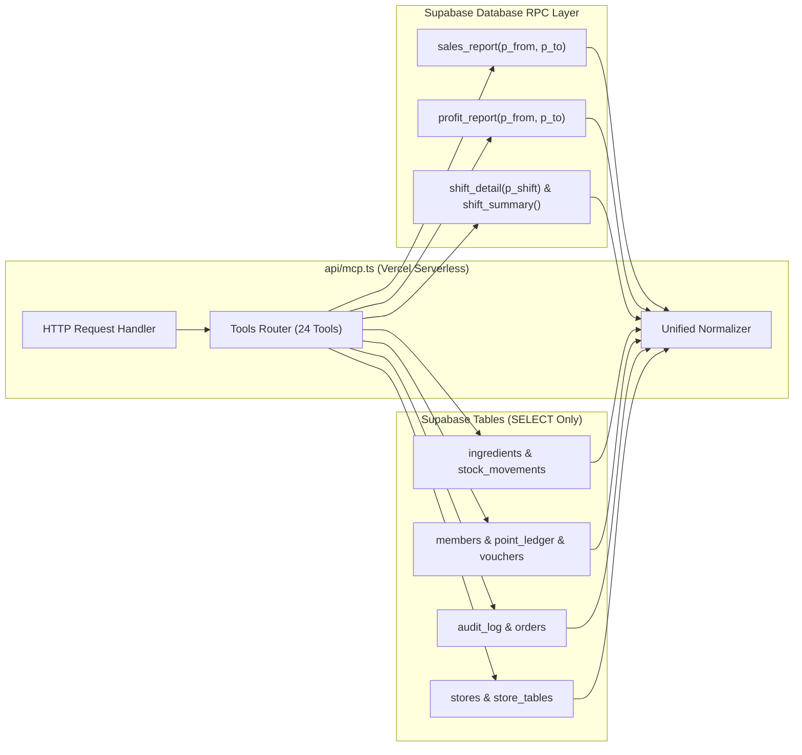

# 01: Arsitektur & Deployment Server MCP POS Intelligence
> **Desain teknis layanan MCP terintegrasi di Vercel Serverless, Pure TypeScript, integrasi Supabase RPC (read-only), spesifikasi 24 tools, dan skema envelope terpadu.**

---

## 1. Desain Struktur Folder Layanan

Lokasi terintegrasi di dalam repo `/home/yoga/Dokumen/pos`:

```text
pos/
├── docs/
│   └── MCP/
│       ├── README.md
│       ├── 00_BUILD_PROMPT.md
│       ├── 01_ARCHITECTURE_AND_DEPLOYMENT.md
│       ├── 02_500_POS_QA_SCENARIOS.md
│       ├── 03_PROMPT_OPTIMIZATION_AND_LLM_JUDGE.md
│       ├── 04_FUTURE_ROADMAP_AND_EXTENSIONS.md
│       └── 05_MCP_CONFIG_AND_VERCEL_GUIDE.md
├── api/
│   ├── rpc.js                     # Gateway RPC web app eksisting
│   ├── mcp.ts                     # ✨ Entrypoint HTTP/SSE Vercel Serverless
│   └── mcp/
│       ├── normalizer.ts          # Envelope seragam, mata uang IDR & date helper
│       ├── auth.ts                # Verifikasi Bearer Token & Multi-tenant store
│       └── tools/
│           ├── sales.ts           # 5 tools: sales overview, daily trend, payment, top menu, cashier
│           ├── profit.ts          # 3 tools: profit summary, product margin, cogs breakdown
│           ├── shifts.ts          # 4 tools: active shift, shift history, detail, cash movements
│           ├── inventory.ts       # 4 tools: low stock alert, portion matrix, stock ledger, purchasing
│           ├── crm.ts             # 3 tools: member leaderboard, points circulation, voucher stats
│           ├── audit.ts           # 3 tools: void/refund report, audit log, anomaly detector
│           └── system.ts          # 2 tools: list stores, health check
├── scripts/
│   └── mcp-server.mjs             # ✨ Runtime lokal Stdio (untuk testing/desktop offline)
├── vercel.json                    # Konfigurasi routing serverless Vercel
└── package.json                   # @modelcontextprotocol/sdk, @supabase/supabase-js, zod
```

---

## 2. Pemilihan Teknologi & Alasan

| Komponen | Pilihan | Alasan |
|:---|:---|:---|
| **Bahasa & Runtime** | Pure TypeScript / JavaScript (Node.js 20+ / Bun) | Menyatu dengan ekosistem POS yang sudah ada; tanpa Python runtime terpisah. |
| **MCP SDK** | `@modelcontextprotocol/sdk` (Official) | SDK resmi Anthropic; mendukung dual transport (HTTP/SSE & Stdio). |
| **Serverless Host** | Vercel Serverless Functions | **100% Gratis** (Hobby plan 100k requests/hari); zero configuration; auto-scale. |
| **Database Connector** | `@supabase/supabase-js` | Reuse client eksisting; memanggil RPC `sales_report` dan query terisolasi. |
| **Skema Validasi** | `zod` | Validasi tipe input parameter tool secara runtime dan aman. |
| **Biaya Operasional** | **Rp 0 / Bulan** | Memanfaatkan free-tier Vercel + Supabase tanpa perlu sewa VPS. |

---

## 3. Integrasi Sumber Data & Aturan Akses



### Aturan Keamanan Database:
1. **100% Read-Only:** Serverless handler hanya menggunakan query `SELECT` dan memanggil fungsi RPC analitik. Tidak mengeksekusi operasi `INSERT`, `UPDATE`, atau `DELETE` pada data transaksi.
2. **Multi-Tenant Isolation:** Setiap query memfilter berdasarkan `store_id` toko yang relevan. Jika pengguna tidak menyebutkan toko, default mengarah ke outlet utama (`warkop-nusantara`).
3. **Penyembunyian Kredensial:** Data sensitif seperti `supervisor_pin`, `password_hash`, `store_secrets`, dan auth tokens diproteksi dan tidak pernah diekspos ke AI payload.

---

## 4. Spesifikasi Lengkap 24 Tools MCP POS

Semua tool menerima parameter tanggal opsional `start_date`, `end_date` (format `YYYY-MM-DD`, default hari ini atau 7 hari terakhir WIB).

### Modul 1: Penjualan & Pendapatan Toko (`sales.ts`)
| # | Tool | Parameter Utama | Deskripsi Output |
|:--|:---|:---|:---|
| 1 | `pos_get_sales_overview` | `start_date`, `end_date`, `store_slug?` | Total omzet kotor, omzet bersih, diskon, pajak, service charge, pembulatan, dan total volume order. |
| 2 | `pos_get_daily_sales_trend` | `days` (7, 30, 90), `store_slug?` | Runtun waktu omzet harian vs jumlah pesanan untuk melihat pola hari ramai vs sepi. |
| 3 | `pos_get_payment_method_breakdown` | `start_date`, `end_date`, `store_slug?` | Distribusi omzet dan frekuensi per metode (CASH, QRIS, TRANSFER, DEBIT). |
| 4 | `pos_get_top_selling_products` | `start_date`, `end_date`, `limit` (default 10) | Ranking menu terlaris berdasarkan kuantitas terjual dan total rupiah yang dihasilkan. |
| 5 | `pos_get_cashier_performance` | `start_date`, `end_date`, `store_slug?` | Produktivitas tiap staf kasir: jumlah nota ditangani dan total kas masuk. |

### Modul 2: Profitabilitas & HPP/COGS (`profit.ts`)
| # | Tool | Parameter Utama | Deskripsi Output |
|:--|:---|:---|:---|
| 6 | `pos_get_profit_summary` | `start_date`, `end_date`, `store_slug?` | Omzet bersih, total HPP bahan terpakai, laba kotor (*gross profit*), dan persentase margin laba. |
| 7 | `pos_get_product_margins` | `start_date`, `end_date`, `limit` | Margin keuntungan per menu (harga jual vs modal resep bahan baku) dan rasio margin %. |
| 8 | `pos_get_cogs_breakdown` | `start_date`, `end_date`, `store_slug?` | Pengeluaran bahan baku tertinggi yang terserap dalam proses produksi menu. |

### Modul 3: Kasir, Shift & Arus Kas Laci (`shifts.ts`)
| # | Tool | Parameter Utama | Deskripsi Output |
|:--|:---|:---|:---|
| 9 | `pos_get_active_shift_status` | `store_slug?` | Informasi shift kasir yang sedang buka saat ini: nama kasir, jam buka, modal awal, kas di sistem. |
| 10 | `pos_get_shift_history` | `start_date`, `end_date`, `limit` | Daftar shift yang sudah ditutup, modal awal, uang hitung fisik, selisih kas (+/-), dan catatan staf. |
| 11 | `pos_get_shift_detail` | `shift_id` | Rincian lengkap 1 shift: breakdown uang tunai, non-tunai, void di shift tersebut, dan kas keluar. |
| 12 | `pos_get_cash_movements` | `start_date`, `end_date`, `kind?` (`IN`/`OUT`) | Histori uang keluar laci (beli es batu, gas, galon) atau uang masuk tambahan di kasir. |

### Modul 4: Inventori, Resep & Stok Dapur (`inventory.ts`)
| # | Tool | Parameter Utama | Deskripsi Output |
|:--|:---|:---|:---|
| 13 | `pos_get_low_stock_alerts` | `store_slug?` | Bahan baku kritis yang sisa fisiknya sudah berada di bawah batas minimum (`stock <= min_stock`). |
| 14 | `pos_get_stock_availability_matrix` | `store_slug?` | Estimasi berapa porsi setiap menu yang masih bisa dibuat berdasarkan stok bahan saat ini. |
| 15 | `pos_get_stock_movement_ledger` | `ingredient_name?`, `start_date`, `end_date` | Kartu mutasi stok: barang terpakai jualan (`SALE`), pembatalan (`VOID`), kulakan (`RESTOCK`), atau penyesuaian (`ADJUST`). |
| 16 | `pos_get_purchase_order_summary` | `start_date`, `end_date` | Rekap pembelian ke supplier: total nilai PO, status bayar, dan status penerimaan barang. |

### Modul 5: Pelanggan, Poin & Promosi (`crm.ts`)
| # | Tool | Parameter Utama | Deskripsi Output |
|:--|:---|:---|:---|
| 17 | `pos_get_member_leaderboard` | `limit` (default 20), `order_by` (`spent`/`visits`) | Pelanggan paling setia: total belanja akumulatif, total kunjungan, dan saldo poin aktif. |
| 18 | `pos_get_points_circulation` | `start_date`, `end_date` | Rekap poin loyalitas: poin didapat pelanggan (*EARN*), poin ditukar diskon (*REDEEM*), dan konversi rupiah. |
| 19 | `pos_get_voucher_effectiveness` | `start_date`, `end_date` | Efektivitas voucher diskon: berapa kali digunakan vs total diskon yang dikeluarkan toko. |

### Modul 6: Audit, Keamanan & Anomali (`audit.ts`)
| # | Tool | Parameter Utama | Deskripsi Output |
|:--|:---|:---|:---|
| 20 | `pos_get_void_refund_report` | `start_date`, `end_date`, `store_slug?` | Rekap nota yang dibatalkan (*VOID*) atau uang kembali (*REFUND*), alasan pembatalan, dan supervisor penyetuju. |
| 21 | `pos_get_security_audit_log` | `start_date`, `end_date`, `action_filter?` | Log jejak audit penting: force close shift, void order, ubah setting toko, edit resep. |
| 22 | `pos_detect_cash_anomalies` | `days` (default 30) | Analisis pola anomali: kasir dengan selisih minus berulang atau rasio void di atas batas wajar. |

### Modul 7: Diagnostik & Multi-Tenant (`system.ts`)
| # | Tool | Parameter Utama | Deskripsi Output |
|:--|:---|:---|:---|
| 23 | `pos_list_stores` | *none* | Daftar cabang toko yang terdaftar di database POS beserta statusnya. |
| 24 | `pos_health_check` | *none* | Tes konektivitas ke database Supabase, latensi query, dan integritas data. |

---

## 5. Skema Envelope Respon Terpadu

Setiap tool mengembalikan objek JSON terstruktur berikut:

```json
{
  "success": true,
  "module": "sales",
  "store": {
    "name": "Warung Kopi Nusantara",
    "slug": "warkop-nusantara"
  },
  "period": {
    "start_date": "2026-11-01",
    "end_date": "2026-11-16",
    "days": 16
  },
  "currency": "IDR",
  "timezone": "Asia/Jakarta",
  "data": [
    {
      "name": "Cafe Latte",
      "qty_sold": 42,
      "total_revenue": 924000
    }
  ],
  "totals": {
    "net_sales": 14258000,
    "order_count": 153,
    "aov": 93190
  },
  "warnings": [],
  "source": {
    "fetched_at": "2026-11-20T17:40:00+07:00",
    "engine": "supabase_rpc"
  }
}
```

---

## 6. Contoh Implementasi Lengkap: `api/mcp.ts`

```typescript
import type { VercelRequest, VercelResponse } from '@vercel/node'
import { Server } from '@modelcontextprotocol/sdk/server/index.js'
import { SSEServerTransport } from '@modelcontextprotocol/sdk/server/sse.js'
import { CallToolRequestSchema, ListToolsRequestSchema } from '@modelcontextprotocol/sdk/types.js'
import { createClient } from '@supabase/supabase-js'

const supabase = createClient(
  process.env.VITE_SUPABASE_URL!,
  process.env.SUPABASE_ACCESS_TOKEN || process.env.VITE_SUPABASE_ANON_KEY!,
  { auth: { persistSession: false } }
)

const server = new Server(
  { name: 'pos-intelligence-mcp', version: '1.0.0' },
  { capabilities: { tools: {} } }
)

server.setRequestHandler(ListToolsRequestSchema, async () => {
  return {
    tools: [
      {
        name: 'pos_get_sales_overview',
        description: 'Mendapatkan ringkasan penjualan POS (omzet bersih, kotor, diskon, pajak, total transaksi) dalam rentang tanggal.',
        inputSchema: {
          type: 'object',
          properties: {
            start_date: { type: 'string', description: 'Format YYYY-MM-DD' },
            end_date: { type: 'string', description: 'Format YYYY-MM-DD' },
            store_slug: { type: 'string', description: 'Slug toko, default warkop-nusantara' }
          },
          required: ['start_date', 'end_date']
        }
      },
      {
        name: 'pos_get_profit_summary',
        description: 'Mendapatkan ringkasan laba kotor & HPP/COGS operasional penjualan POS.',
        inputSchema: {
          type: 'object',
          properties: {
            start_date: { type: 'string', description: 'Format YYYY-MM-DD' },
            end_date: { type: 'string', description: 'Format YYYY-MM-DD' }
          },
          required: ['start_date', 'end_date']
        }
      },
      {
        name: 'pos_get_low_stock_alerts',
        description: 'Mendapatkan daftar bahan baku yang stok fisiknya sudah kritis di bawah batas minimum.',
        inputSchema: {
          type: 'object',
          properties: {
            store_slug: { type: 'string', description: 'Slug toko' }
          }
        }
      }
    ]
  }
})

server.setRequestHandler(CallToolRequestSchema, async (request) => {
  const { name, arguments: args } = request.params

  try {
    if (name === 'pos_get_sales_overview') {
      const { start_date, end_date } = args as { start_date: string; end_date: string }
      const { data, error } = await supabase.rpc('sales_report', { p_from: start_date, p_to: end_date })
      if (error) throw new Error(error.message)

      return {
        content: [{
          type: 'text',
          text: JSON.stringify({
            success: true,
            module: 'sales',
            period: { start_date, end_date },
            currency: 'IDR',
            totals: data.totals,
            by_method: data.by_method,
            top_products: data.top_products.slice(0, 10)
          }, null, 2)
        }]
      }
    }

    if (name === 'pos_get_low_stock_alerts') {
      const { data, error } = await supabase
        .from('ingredients')
        .select('name, unit, stock, min_stock')
        .eq('is_active', true)
        .filter('stock', 'lte', 'min_stock')

      if (error) throw new Error(error.message)

      return {
        content: [{
          type: 'text',
          text: JSON.stringify({
            success: true,
            module: 'inventory',
            critical_items: data
          }, null, 2)
        }]
      }
    }

    throw new Error(`Tool ${name} belum terdaftar`)
  } catch (err: any) {
    return {
      isError: true,
      content: [{ type: 'text', text: `Error: ${err.message}` }]
    }
  }
})

export default async function handler(req: VercelRequest, res: VercelResponse) {
  // Autentikasi Kunci Rahasia
  const authHeader = req.headers.authorization
  const expectedKey = process.env.MCP_SECRET_KEY
  if (expectedKey && authHeader !== `Bearer ${expectedKey}`) {
    return res.status(401).json({ error: 'Unauthorized: Kunci API MCP tidak valid.' })
  }

  // Handle JSON-RPC POST (Streamable HTTP)
  if (req.method === 'POST') {
    res.setHeader('Content-Type', 'application/json')
    const response = await server.handleJsonRpcMessage(req.body)
    return res.status(200).json(response)
  }

  // Handle SSE Handshake GET
  if (req.method === 'GET') {
    const transport = new SSEServerTransport('/api/mcp', res)
    await server.connect(transport)
    return
  }

  return res.status(405).json({ error: 'Method not allowed' })
}
```

