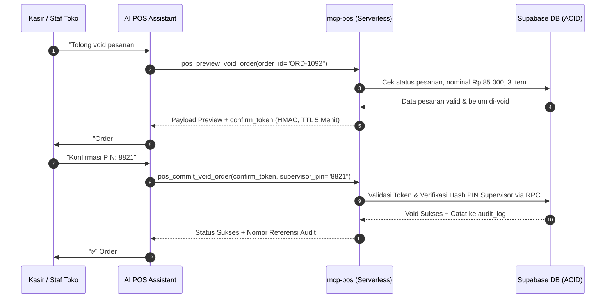
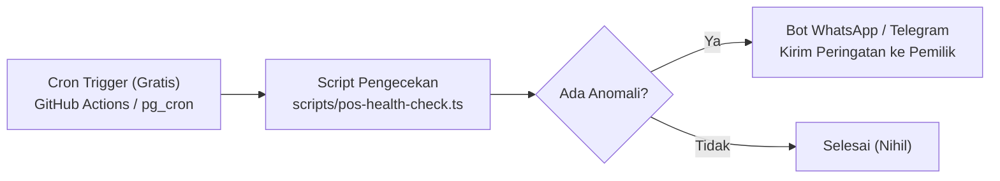
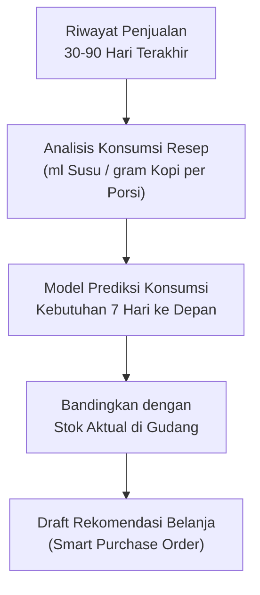

# 04: Future Roadmap & Future-Proofing Architecture
> **Rencana pengembangan jangka panjang `mcp-pos`: Gated Write Actions, Proactive Alerting, Multi-Store Benchmarking, dan AI Demand Forecasting.**

---

## 🧭 Prinsip Arsitektur

Fase 1 dari `mcp-pos` dirancang sengaja mengusung prinsip:
1. **100% GRATIS (Rp 0)**: Memanfaatkan Vercel Hobby Serverless dan Supabase Free Tier tanpa biaya sewa VPS atau cloud compute berbayar.
2. **Pure TypeScript**: Runtime ultra-ringan, minim cold start (< 150ms), dan langsung kompatibel dengan ekosistem POS yang sudah ada.
3. **Read-Only First**: Menghindari risiko kesalahan pembatalan transaksi, manipulasi uang laci kasir, atau kerusakan data stok bahan baku oleh kecerdasan buatan.
4. **Pondasi Envelope & RPC Terstandarisasi**: Seluruh response tool menggunakan skema envelope seragam (`success`, `data`, `warnings`, `timestamp`, `metadata`), sehingga penambahan aksi mutasi atau fitur multi-cabang tidak akan merusak kompatibilitas klien AI yang sudah berjalan.

---

## 1. Gated Write Actions (Pola Preview → Commit)

### ⚠️ Risiko Mutasi Langsung oleh AI
Membiarkan model bahasa mengeksekusi aksi mutasi data secara langsung (seperti pembatalan transaksi / void, perubahan harga jual, penyesuaian stok, atau kas keluar manual) sangat berisiko:
- Potensi halusinasi parameter jumlah uang atau ID pesanan.
- Pelanggaran SOP kasir dan celah manipulasi keuangan oleh kasir nakal yang memanfaatkan antarmuka chat.

### 💡 Solusi: Pola Preview → Commit dengan Supervisor Approval PIN



### Mekanisme Keamanan Gated Mutation:
1. **Feature Flag**: Variabel lingkungan `POS_ENABLE_WRITE_ACTIONS=false` secara default. Hanya diaktifkan bila pemilik toko menyetujui mode interaktif.
2. **HMAC Timed Token (`confirm_token`)**:
   - Berisi payload terenkripsi: `order_id`, `action`, `user_id`, dan `expires_at`.
   - Masa berlaku dibatasi maksimal 5 menit (TTL). Setelah 5 menit token kedaluwarsa otomatis.
3. **Pemberian Otorisasi PIN Fisik**: Supervisor atau Store Manager wajib menginput PIN verifikasi yang dicocokkan dengan hash bcrypt di tabel pengguna database.
4. **Jejak Audit Kekal (Append-Only)**: Setiap aksi yang berhasil dicatat ke tabel `audit_log` dengan rincian identitas pelaksana, IP address, waktu presisi, dan alasan tindakan.

---

## 2. Proactive Alerting & Scheduled Jobs

### ⚠️ Keterbatasan Pola MCP Tradisional
Protokol MCP berbasis permintaan (*Pull-based*): asisten AI baru memberikan analisis saat pengguna bertanya. Padahal, insiden operasional di restoran/toko sering kali memerlukan peringatan dini (*Push-based*).

### 💡 Solusi: Integrasi Serverless Scheduled Bot (Rp 0)
Memanfaatkan **GitHub Actions Scheduled Workflow** atau **Supabase pg_cron** gratis untuk menjalankan pengecekan terjadwal:



### Skenario Alerting Utama:
1. **Peringatan Shift Kasir Gantung**:
   - Jika shift kasir aktif melebihi 16 jam tanpa ada penutupan (closing), sistem otomatis mengirim peringatan ke nomor WhatsApp manajer toko:
     > ⚠️ *Peringatan Shift Gantung*: Shift kasir atas nama 'Budi' telah aktif selama 17 jam tanpa closing. Segera lakukan serah terima kasir.
2. **Anomali Selisih Uang Laci**:
   - Jika penutupan shift mencatat selisih fisik kas (minus atau plus) melebihi batas toleransi (misal > Rp 20.000), peringatan instan dikirim ke Auditor Internal.
3. **Bahan Baku Menipis Mendekati Batas Kritis**:
   - Pengecekan jam 16:00 (sebelum peak hour sore/malam) terhadap sisa stok susu segar, biji kopi, atau cup packaging.
4. **Executive Morning & Evening Briefing**:
   - **Jam 08:00 WIB (Morning Brief)**: Ringkasan target penjualan hari ini, sisa bahan kritis yang harus dibelanjakan pagi ini, dan jadwal kasir yang bertugas.
   - **Jam 22:30 WIB (Night Brief)**: Ringkasan total omzet hari ini, capaian laba kotor, status closing shift seluruh kasir, dan daftar menu terlaris hari ini.

---

## 3. Multi-Store / Multi-Outlet Benchmarking

Bagi pemilik bisnis yang memiliki lebih dari satu cabang/outlet (misalnya Cabang Sudirman vs Cabang Tebet):

| Kapabilitas Baru | Deskripsi | Manfaat Bisnis |
|:---|:---|:---|
| **Filter Parameter `store_id`** | Setiap RPC Supabase diperkaya dengan parameter opsional `p_store_id uuid`. | Memungkinkan perbandingan performa per cabang atau agregasi seluruh grup usaha. |
| **Cross-Store Sales Comparison** | Membandingkan omzet harian dan rata-rata belanja (AOV) antar outlet. | Mengetahui cabang dengan performa tertinggi dan yang memerlukan promosi tambahan. |
| **Food Cost & HPP Benchmarking** | Menghitung rasio HPP antar cabang untuk menu yang sama. | Mendeteksi inefisiensi porsi atau indikasi pemborosan bahan baku di cabang tertentu. |
| **Inter-Branch Stock Transfer** | Memonitor perpindahan stok bahan baku dari gudang utama ke outlet cabang. | Menjaga keseimbangan inventori tanpa overstock di salah satu cabang. |

---

## 4. AI Demand Forecasting & Smart Restock Suggestion

### 💡 Konsep Prediksi Kebutuhan Bahan Baku
Mengombinasikan riwayat konsumsi bahan baku dari transaksi 30–90 hari terakhir dengan algoritma regresi linier / musiman (misal: akhir pekan selalu terjadi kenaikan penjualan minuman kopi sebesar +40%):



### Contoh Output Rekomendasi Belanja Otomatis:
```markdown
### 📦 Rekomendasi Pengadaan Bahan Baku (Periode: 17–23 Nov 2026)
Berdasarkan tren lonjakan pelanggan di akhir pekan, berikut bahan yang harus di-restock sebelum Jumat:

1. **Susu Fresh Milk (Diamond / Greenfields)**
   - Sisa Stok Aktual: 12 Liter
   - Estimasi Kebutuhan Akhir Pekan: 45 Liter
   - **Rekomendasi Pembelian: 35 Liter (± Rp 700.000)**

2. **Biji Kopi House Blend Espresso**
   - Sisa Stok Aktual: 2,5 Kg
   - Estimasi Kebutuhan Akhir Pekan: 7 Kg
   - **Rekomendasi Pembelian: 5 Kg (± Rp 600.000)**

3. **Gelas Cup Plastik 16oz + Tutup Seal**
   - Sisa Stok Aktual: 150 pcs
   - Estimasi Kebutuhan Akhir Pekan: 500 pcs
   - **Rekomendasi Pembelian: 1 Dus / 1.000 pcs (± Rp 350.000)**
```
Format ini dapat langsung diteruskan oleh tim purchasing melalui WhatsApp kepada pemasok bahan baku toko.

