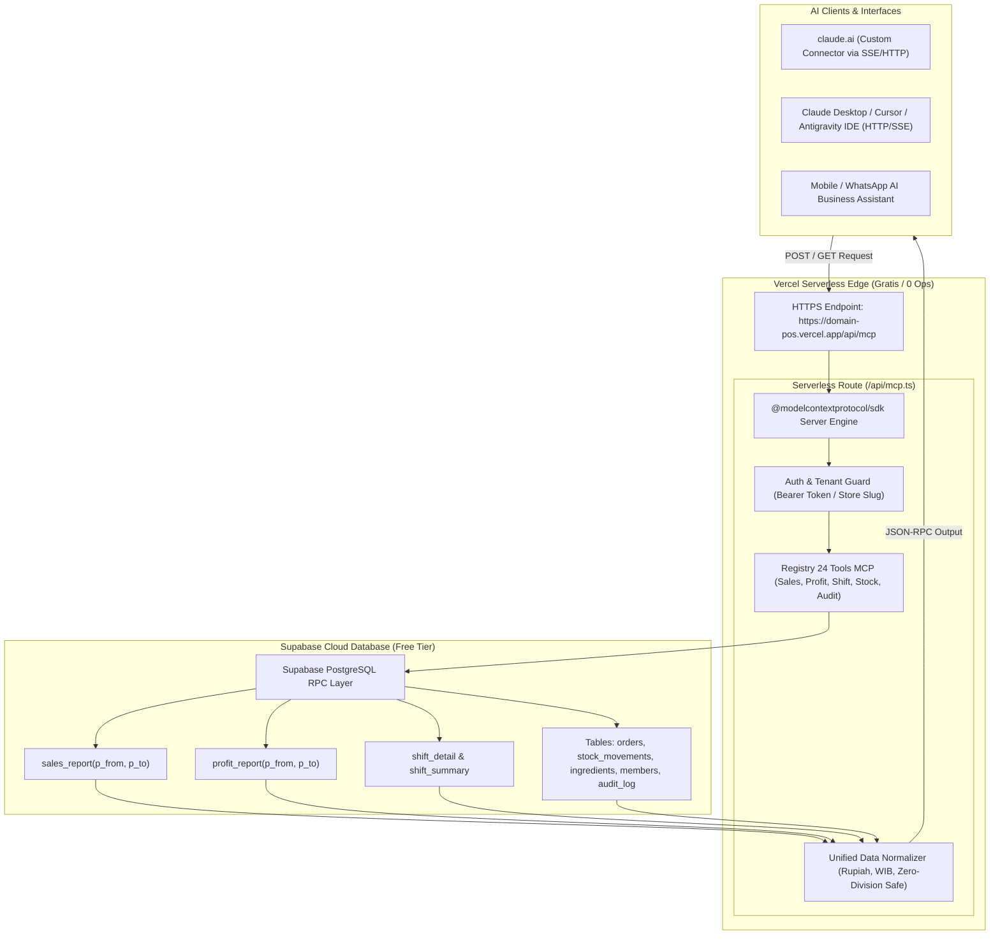

# Master Plan: Standalone MCP POS Intelligence Service (Point of Sale & Backoffice)
> **Sistem AI Asisten Analisis Laporan & Intelijen Bisnis POS Terpadu (Penjualan, HPP/Profit, Kasir/Shift, Inventori, Member & Audit), Berbasis Model Context Protocol (MCP) 100% Pure JavaScript/TypeScript & Siap Deploy ke Vercel Serverless (100% Gratis)**

---

## 📌 Ringkasan Eksekutif (Executive Summary)

Dokumen ini adalah cetak biru arsitektur lengkap untuk membangun dan mendeploy **MCP Server terintegrasi (*serverless microservice*)** bernama **`mcp_pos`** di dalam repositori POS ini. Layanan ini bertindak sebagai **AI Q&A Assistant & Business Intelligence Agent** untuk menganalisis data operasional kasir, penjualan, profitabilitas (HPP/COGS), mutasi stok, performa staf, hingga jejak audit keamanan kasir.

### Mengapa Pure JavaScript/TypeScript & Vercel Serverless (100% Gratis)?
| Parameter | Arsitektur Python + VPS (Tradisional) | Arsitektur Pure JS/TS + Vercel (Dokumen Ini) |
|:---|:---|:---|
| **Biaya Bulanan** | Berbayar ($5–$12/bulan untuk VPS Linode/DigitalOcean) | **100% GRATIS (Rp 0)** via Vercel Hobby Plan |
| **Runtime & Bahasa** | Python 3.11 + Uvicorn + FastMCP + virtualenv | **Pure JS/TypeScript** (Node.js/Bun) menyatu dengan stack POS |
| **Database Connector** | Butuh install `psycopg2` / `asyncpg` + SSL cert | Reuse `@supabase/supabase-js` yang sudah ada |
| **Operasional & Maintenance** | Patching OS Linux, config Nginx, SSL Certbot, PM2 | **Zero Ops**: Otomatis aktif saat `git push` ke Vercel |
| **Cold Start & Latensi** | 2–5 detik di serverless karena bundle Python besar | **< 100 ms** (Vercel Node runtime sangat ringan) |
| **Deployment Mode** | Server harus standby 24/7 memakan RAM VPS | **Serverless On-Demand**: Hanya jalan saat AI bertanya |

### Prinsip Utama Sistem:
1. **100% Gratis Tanpa Biaya Tambahan**: Memanfaatkan kuota gratis Vercel Serverless (100.000 requests/hari) dan database Supabase Free Tier yang sudah aktif.
2. **Pure TypeScript/JavaScript**: Dibangun dengan SDK resmi Anthropic `@modelcontextprotocol/sdk`, tanpa ketergantungan pada runtime Python, pip, atau virtual environment.
3. **100% Read-Only di Fase 1**: Menjamin keamanan mutlak. AI hanya diizinkan membaca laporan, agregasi, dan mutasi data. Tidak ada aksi yang dapat mengubah uang, membatalkan pesanan, atau merusak stok.
4. **Gated Mutation di Fase 2 (Opsional)**: Perubahan master data atau otorisasi void hanya melalui pola konfirmasi dua langkah (*two-step confirmation* preview → commit via PIN supervisor).
5. **Skema Metrik Terpadu (Unified Envelope)**: Semua output moneter dalam format **IDR (Rupiah)**, zona waktu baku **WIB (Asia/Jakarta)**, dan rasio matematis dihitung ulang di server (*null-safe*).
6. **Integrasi Langsung RPC Supabase**: Memanfaatkan stored procedure yang sudah teruji di database (`sales_report`, `profit_report`, `shift_detail`, `shift_summary`).
7. **Katalog 100 Skenario Uji + LLM-as-a-Judge**: Evaluasi otomatis berbasis rubrik G-Eval 5 dimensi untuk memastikan AI tidak berhalusinasi angka uang atau stok.

---

## 🗺️ Peta Navigasi Dokumen

| No | Modul Dokumen | Deskripsi Isi | Tautan |
|:---|:---|:---|:---|
| **00** | **Build Prompt** | Prompt lengkap siap tempel ke agen coding (Antigravity / Claude Code / Cursor) untuk membangun `mcp_pos` dari nol. | [`00_BUILD_PROMPT.md`](./00_BUILD_PROMPT.md) |
| **01** | **Arsitektur & Deployment** | Desain folder, arsitektur serverless, spesifikasi lengkap 24 tools MCP, envelope data, dan implementasi `api/mcp.ts`. | [`01_ARCHITECTURE_AND_DEPLOYMENT.md`](./01_ARCHITECTURE_AND_DEPLOYMENT.md) |
| **02** | **Katalog 500 Skenario QA** | 500 pertanyaan operasional nyata (Owner, Manager, Kasir, Barista, Finance, Gudang), lengkap dengan parameter dan ekspektasi metrik respons efektif. | [`02_500_POS_QA_SCENARIOS.md`](./02_500_POS_QA_SCENARIOS.md) |
| **03** | **Prompt Optimization & LLM Judge** | System prompt produksi, guardrail anti-halusinasi uang kas/stok, rubrik evaluasi 5 dimensi, dan pipeline automated testing. | [`03_PROMPT_OPTIMIZATION_AND_LLM_JUDGE.md`](./03_PROMPT_OPTIMIZATION_AND_LLM_JUDGE.md) |
| **04** | **Future Roadmap** | Gated write actions (approval void/diskon), notifikasi anomali via WhatsApp Bot, multi-cabang analytics, dan prediksi stok. | [`04_FUTURE_ROADMAP_AND_EXTENSIONS.md`](./04_FUTURE_ROADMAP_AND_EXTENSIONS.md) |
| **05** | **Konfigurasi MCP & Vercel Guide** | Konfigurasi `.env`, `vercel.json`, setup `mcp_config.json` di Claude Desktop, Antigravity IDE, Cursor, dan claude.ai. | [`05_MCP_CONFIG_AND_VERCEL_GUIDE.md`](./05_MCP_CONFIG_AND_VERCEL_GUIDE.md) |

---

## 🏗️ Diagram Arsitektur Tingkat Tinggi

---

## 📊 Matriks Fitur & Kemampuan Layanan

| Aspek | Spesifikasi Teknis `mcp_pos` |
|:---|:---|
| **Protokol** | Model Context Protocol (Streamable HTTP, SSE & Stdio lokal) |
| **Lokasi File** | `api/mcp.ts` (Vercel Endpoint) & `scripts/mcp-server.mjs` (Lokal Stdio) |
| **Bahasa & Runtime** | Pure TypeScript / JavaScript (Node.js 20+ / Bun) |
| **Framework MCP** | `@modelcontextprotocol/sdk` (Official SDK Anthropic) |
| **Koneksi Database** | `@supabase/supabase-js` (Direct RPC & Query via Transaction Pooler) |
| **Metode Akses Fase 1** | **100% Read-Only** (Menganalisis tanpa merusak transaksi) |
| **Metode Akses Fase 2** | Gated actions (approval void / opname stok via supervisor PIN) |
| **Format Angka** | IDR (Rupiah baku), pemisah ribuan titik, desimal nol disesuaikan |
| **Zona Waktu** | WIB (`Asia/Jakarta`), tanggal ISO `YYYY-MM-DD` |
| **Keamanan** | Header Authorization Bearer Secret, auto-redaction token/PIN kasir |
| **Biaya Total** | **100% GRATIS (Rp 0)** selamanya di Vercel Hobby + Supabase Free |

